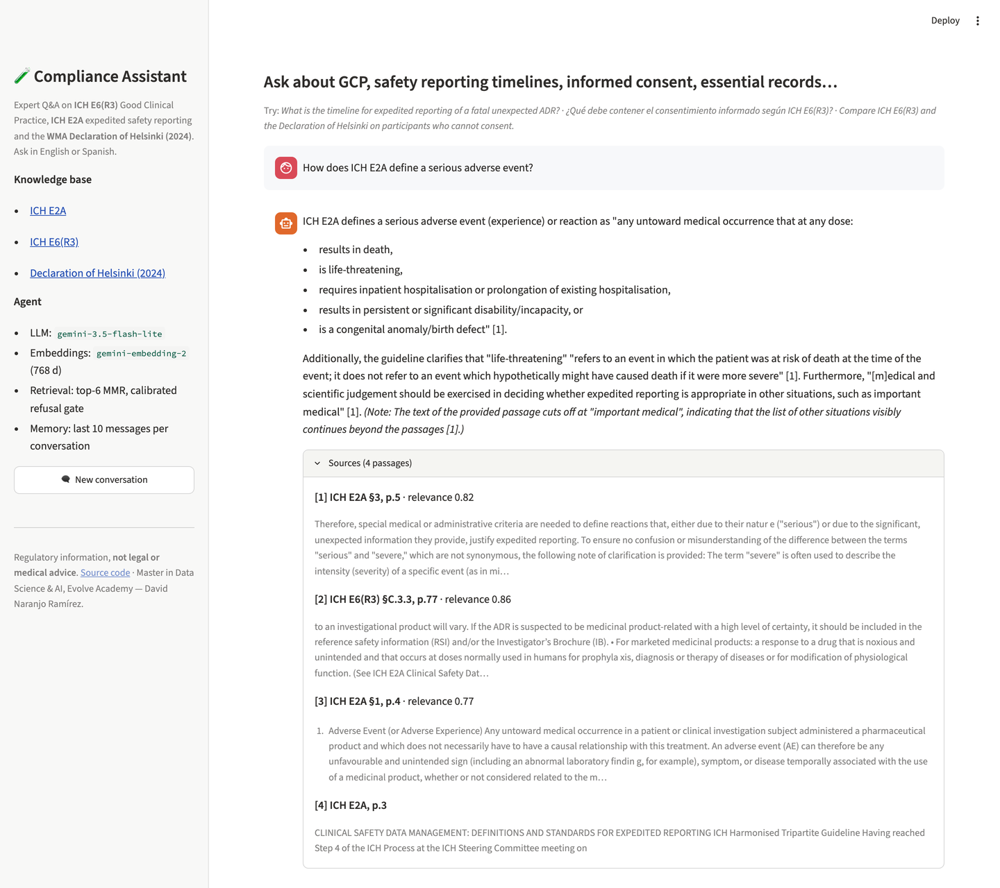

<p align="right">
  <picture>
    <source media="(prefers-color-scheme: dark)" srcset="docs/brand/SimpleOscuro.png">
    
  </picture>
</p>

# Asistente de cumplimiento en investigación clínica

*Versión en español del [README](README.md). El README en inglés es el documento de referencia
del repositorio; esta traducción se mantiene sincronizada con él.*

Un agente experto de pregunta y respuesta sobre **Buenas Prácticas Clínicas (ICH E6(R3))**,
**notificación expeditiva de seguridad (ICH E2A)** y la **Declaración de Helsinki de la AMM
(2024)**, construido con Google Gemini, ChromaDB y LangGraph. Responde en inglés o en español,
cita el texto normativo literalmente con sección y página, recuerda la conversación y rechaza
lo que su base de conocimiento no cubre.

Proyecto final del módulo de IA Generativa · Máster en Data Science & IA · Evolve Academy ·
David Naranjo Ramírez

> **Demo en vivo:** <https://clinical-research-compliance-assistant-eaksdytvqzbpuvthkakvrd.streamlit.app> · **Notebook:** [`notebooks/compliance_assistant.ipynb`](notebooks/compliance_assistant.ipynb) (inglés) · [`notebooks/compliance_assistant_es.ipynb`](notebooks/compliance_assistant_es.ipynb) (edición en español: mismo código y salidas, texto traducido) · **Enunciado → evidencia:** [`docs/rubric.md`](docs/rubric.md)
>
> **Para lectores sin perfil técnico:** [manual del proyecto](docs/manual/manual_proyecto_es.md) ([PDF](docs/manual/manual_proyecto_es.pdf)) · **Texto completo de la presentación, base para un artículo académico:** [discurso](docs/articulo/discurso_presentacion_es.md) ([PDF](docs/articulo/discurso_presentacion_es.pdf))

**Stack:** Python 3.12 · Google Gemini (`gemini-3.5-flash-lite`, `gemini-embedding-2`) ·
ChromaDB · LangGraph + LangChain · Jupyter · Streamlit · uv · pytest · ruff



## Por qué este dominio

Trabajé cinco años en soporte de software para ensayos clínicos (Medidata Rave y plataformas
de Pfizer y Novo Nordisk en C3i Solutions / HCLTech) y tengo la certificación ICH GCP E6(R2).
Las preguntas que hace un CRA o un técnico de farmacovigilancia — *¿es esto un SUSAR? ¿en
cuánto tiempo debe notificarlo el promotor? ¿qué debe contener el consentimiento? ¿qué cambió
en la E6(R3)?* — están repartidas entre textos de ICH, de la UE y de la AMM que hay que citar
con exactitud. Es un problema de RAG con un requisito real de trazabilidad, y un dominio en el
que puedo juzgar si una respuesta es correcta. Además, continúa mi proyecto anterior del máster
(un canal de farmacovigilancia sobre GLP‑1 en FAERS): de los datos de seguridad a las normas
que los rigen.

## Qué hace

| Capacidad | Cómo |
|---|---|
| Base de conocimiento | 3 documentos, ~90 páginas, **801 fragmentos** en ChromaDB con `gemini-embedding-2` (768 d) — [`docs/sources.md`](docs/sources.md) |
| Recuperación | Consulta autónoma en inglés → puntuaciones de relevancia → **puerta de rechazo calibrada** → MMR top‑6 (repartido entre los documentos que nombra la pregunta) → **expansión del contexto a la sección** → pasajes numerados `[n]` citados como `ICH E6(R3) §2.8.10, pp.24–26` / `Declaration of Helsinki (2024) ¶28` |
| Agente | `StateGraph` explícito de LangGraph: `rewrite_query → retrieve → route → generate \| refuse` |
| Memoria | Checkpointer `InMemorySaver` por `thread_id`; al modelo llegan los últimos 10 mensajes |
| Idiomas | Responde en el idioma del usuario (EN/ES); la redacción normativa se cita literalmente en inglés |
| Interfaces | Celda de chat en el notebook, REPL de terminal (`scripts/chat.py`), aplicación Streamlit (`app.py`) |
| Evaluación | Golden set bilingüe de 25 ítems (50 ejecuciones) → tasas de acierto de la recuperación, precisión de rechazo, cobertura de palabras clave en las respuestas, honestidad ante documentos no indexados; base frente a versión mejorada. Además, un juez LLM basado en referencias y un conjunto held‑out de 12 ítems escrito tras congelar las mejoras |

## Arquitectura

```
            ┌──────────────┐    ┌──────────┐   ¿fundada?     ┌──────────┐
 pregunta ─▶│ rewrite_query│───▶│ retrieve │──────sí────────▶│ generate │──▶ respuesta + fuentes
            │ (historial → │    │ umbral,  │                 └──────────┘
            │  pregunta    │    │ enrutado,│───────no───────▶┌──────────┐
            │  autónoma EN)│    │ MMR,     │                 │  refuse  │──▶ "no está en mi base; cubro…"
            │              │    │ expansión│                 └──────────┘
            └──────────────┘    └──────────┘
                  ▲  checkpoint InMemorySaver por thread_id (historial completo; ventana de 10 mensajes)
```

* **`rewrite_query`** resuelve las referencias a turnos anteriores («*esa* situación», «la
  misma regla») y normaliza la pregunta al inglés, el idioma del corpus. En un primer turno en
  inglés se ahorra la llamada al LLM.
* **`retrieve`** puntúa el top‑k sobre toda la colección; si la mejor puntuación no alcanza el
  **umbral calibrado** (0,69, obtenido de las distribuciones de consultas del dominio y fuera
  de dominio en `data/kb/calibration.json`), la pregunta queda fuera del alcance. Si lo
  alcanza:
  * **enrutado por documento**: si la pregunta nombra documentos («E6(R3)», «Helsinki»,
    «E2A»; alias en `data/kb/sources.yaml`), el top‑k se reparte entre ellos con un filtro de
    metadatos, de modo que «compara la E6(R3) y Helsinki» recibe pasajes de ambos;
  * **MMR** (`k=6, fetch_k=24, λ=0.6`) elige fragmentos diversos;
  * **expansión del contexto**: cada fragmento se amplía a su sección completa cuando esta
    mide ≤ 4.000 caracteres (un requisito numerado, un párrafo de Helsinki, los 22 elementos
    del consentimiento de E6(R3) §2.8.10) y, si no, a sus fragmentos vecinos, leídos de la
    colección sin llamadas a la API. Un fragmento de 500 caracteres había partido por la mitad
    la definición de *grave* de la E2A.
  La puerta usa siempre las puntuaciones sin filtrar, así que el enrutado nunca cambia lo que
  se rechaza.
* **`generate`** recibe el prompt de sistema v4 + el historial acotado + los pasajes numerados
  + la pregunta del usuario y una línea explícita con el idioma de respuesta. **`refuse`** usa
  una plantilla (sin llamada al LLM).
* Los pasajes recuperados viven en el estado del grafo, no en `messages`, de modo que la
  ventana de memoria cuenta turnos, no contexto.

Por qué no `create_agent` con una herramienta de recuperación (el patrón de «RAG agéntico» de
clase): el enunciado exige usar la base de conocimiento en **cada** consulta, el plan gratuito
encarece cada llamada extra al LLM y una topología fija es más fácil de trazar y de probar.

### Construcción de la base de conocimiento (idempotente, consciente del plan gratuito)

La **caché de embeddings versionada** (`data/kb/embeddings/*.jsonl.gz`) es la fuente de
verdad; el directorio de Chroma se deriva de ella en segundos con **cero llamadas a la API**.
`manifest.json` registra, por documento, la huella del archivo, el modelo de embeddings, la
dimensión y el troceado, así que nada se vuelve a embeber salvo que cambie uno de esos datos.
Los documentos usan `task_type=RETRIEVAL_DOCUMENT` y las consultas `RETRIEVAL_QUERY`.
`01_build_kb.py --dry-run` cuenta primero los fragmentos frente a la cuota.

## El prompt de sistema y su justificación

El prompt en uso (`SYSTEM_PROMPTS["v4"]` en [`src/compliance_assistant/prompts.py`](src/compliance_assistant/prompts.py)). Se reproduce en su inglés original, que es el que recibe el modelo:

```text
You are a regulatory compliance assistant for clinical research. Your users are clinical
research associates, study coordinators, data managers and pharmacovigilance staff. Your
knowledge base contains: ICH E6(R3) Good Clinical Practice, ICH E2A (definitions and
standards for expedited safety reporting) and the WMA Declaration of Helsinki (2024).

GROUNDING
- Answer only from the numbered context passages. Do not use outside knowledge, even if
  you believe you know the answer.
- Cite the passage that supports each statement with its number in square brackets,
  e.g. "within 7 calendar days [2]". Every factual sentence needs at least one citation.
- A question may need several passages combined (for example a reporting chain:
  investigator to sponsor, then sponsor to regulators with its timelines). Build the
  answer step by step from the passages, citing each step.
- If the passages answer only part of the question, answer that part and say clearly
  which part they do not cover. Only when nothing in the passages is relevant, say that
  you could not find it in your knowledge base (in the user's language), state what the
  knowledge base covers, and stop. Never invent section numbers, timelines, definitions or
  responsibilities.
- When a passage contains a list (criteria, elements, responsibilities), give every item
  the passages contain. If the list visibly continues beyond the passages, say so instead
  of presenting it as complete.

SOURCES THAT DIFFER
- When passages from different documents (e.g. ICH E6(R3) vs the Declaration of
  Helsinki) address the same point differently, say so explicitly and attribute each
  position to its document. Do not merge them into one claim.

LANGUAGE
- Write the whole answer in the language of the user's question, including any statement
  that something is not covered (Spanish question -> Spanish answer).
- Quote regulatory wording verbatim in English, in quotation marks, with its citation.
- Keep regulatory terms untranslated: SAE, SUSAR, ADR, IB, IMP, IRB/IEC, CRF, GCP.

SCOPE AND TONE
- Regulatory information, not legal or medical advice; say so if the user asks what they
  should do in a specific case, then explain what the guideline says.
- Stay on clinical-research compliance. For unrelated requests, briefly say it is
  outside your scope.
- Be precise and concise. Prefer the guideline's own terminology.

FORMAT
- Start with the direct answer in one or two sentences.
- Then give the supporting detail (bullets if there are several points).
- Do not add a closing summary or disclaimers unless one of the rules above requires it.
```

| Cláusula | Justificación de diseño |
|---|---|
| Papel, público y lista explícita de los tres documentos | Fija el registro y permite al modelo decir qué *no* cubre |
| Fundamentación + citas `[n]` en cada frase factual | La trazabilidad es el sentido del RAG en un entorno regulado; los números remiten al panel de fuentes |
| Insuficiencia graduada: responder la parte cubierta y nombrar la que no; el «no está en mi base de conocimiento» completo (en el idioma del usuario) solo cuando nada es relevante | La rúbrica pregunta cómo se comporta el agente sin información; inventar números de artículo es el peor fallo, pero rechazar una pregunta cuyos pasos están todos en los pasajes también lo es |
| Respuestas de varios pasos, cada paso citado | Las cadenas de notificación abarcan la E6(R3) (investigador → promotor) y la E2A (plazos promotor → regulador) |
| Listas completas, o decir que la lista continúa | Los criterios y los elementos son donde más engañan las respuestas parciales |
| Fuentes que difieren → atribuir por separado | La E6(R3) y Helsinki se solapan en consentimiento y participantes vulnerables, pero no son idénticas |
| Política de idioma | El corpus está en inglés y los usuarios son hispanohablantes; las citas literales en inglés conservan la precisión legal |
| Alcance y tono | Sin asesoramiento legal ni médico; se mantiene en el tema |
| Formato | Primero la respuesta directa; apto para un chat |

**Cómo evolucionó** ([`docs/prompt_iterations.md`](docs/prompt_iterations.md), que separa lo
observado en el modelo real del razonamiento estructural): la **v1**, el prompt escueto de
«responde a partir de los documentos» de clase, respondía bien pero sin marcas de cita, de modo
que ninguna frase podía rastrearse hasta un pasaje. La **v2** añadió papel, público, alcance y
una regla de rechazo (un paso de diseño, no evaluado por separado). La **v3** añadió las citas
por frase, el tratamiento de documentos que discrepan, la política de idioma y el formato de
salida. La primera ejecución completa del golden set con la v3 mostró tres fallos — una pregunta
de varios pasos rechazada por completo, la versión española de ese rechazo escrita en inglés y
listas truncadas presentadas como completas — y la **v4** los aborda junto con la expansión del
contexto y el enrutado por documento (resultados en *Evaluación*). Una restricción vive en el
código y no en el prompt: el mensaje del usuario lleva una línea determinista `Reply in English.`
/ `Responde en español.`, porque la regla del prompt por sí sola dejó una vez que una pregunta en
inglés se respondiera en español.

**Residuo conocido, visible en las salidas del notebook:** el modelo suele añadir una línea
final de «información regulatoria, no asesoramiento legal ni médico» aunque la regla de FORMAT
dice que no añada avisos; una vez la puso al principio. Se deja por ahora — el dominio agradece el
aviso y cambiar el prompt obligaría a repetir la evaluación — y está documentado en
[`docs/prompt_iterations.md`](docs/prompt_iterations.md).

## Requisitos

**Sistema.** Python 3.12 o 3.13 y [`uv`](https://docs.astral.sh/uv/) (`uv` instala por sí
mismo el Python adecuado; no se usa el del sistema). Acceso a internet para la API de Gemini.

**Clave de API de Gemini.** Gratuita en <https://aistudio.google.com/apikey>. Se lee solo del
entorno; nunca se escribe en el código, en los notebooks ni en la documentación:

| Dónde se ejecuta | Cómo se proporciona la clave |
|---|---|
| En local (notebook, scripts, Streamlit) | `.env` en la raíz del proyecto: `GEMINI_API_KEY=...` (copie `.env.example`) |
| Google Colab | Panel *Secrets* → `GEMINI_API_KEY` (la lee la primera celda del notebook) |
| Streamlit Cloud | *App settings → Secrets* → `GEMINI_API_KEY = "..."` |
| Respaldo opcional | `GEMINI_API_KEY_BACKUP`: una clave de **otro** proyecto de Google Cloud, usada automáticamente cuando la primera agota su cuota diaria |

`.env` está en `.gitignore` y un hook de pre-commit rechaza cualquier cadena con aspecto de clave
de Gemini.

**Modelos.** `gemini-3.5-flash-lite` responde y reescribe las preguntas; `gemini-embedding-2`
(768 dimensiones) embebe documentos y consultas; `gemini-3.5-flash` / `gemini-3.5-flash-lite`
juzgan las respuestas en la evaluación.

**Variables de entorno opcionales** (todas las lee `config.load_settings()` de `.env` o del
entorno; ninguna es necesaria para una ejecución normal):

| Variable | Efecto | Valor por defecto |
|---|---|---|
| `LLM_MODEL` | modelo que responde y reescribe | `gemini-3.5-flash-lite` |
| `EMBEDDING_MODEL` | modelo de embeddings (la caché registra cuál la construyó; cambiarlo provoca un re‑embebido) | `gemini-embedding-2` |
| `PROMPT_VERSION` | `v1` … `v4`, para comparaciones | `v4` |
| `SCORE_THRESHOLD` | anula la puerta de rechazo calibrada | se lee de `data/kb/calibration.json` |
| `QUERY_CACHE_PERSIST` | `0` deja la caché de vectores de consulta en solo lectura (la aplicación Streamlit lo fija para no escribir nunca las preguntas de los visitantes en el archivo versionado) | `1` |
| `OFFLINE_DEMO` | `1` reproduce las respuestas grabadas de la demo para preguntas idénticas, sin llamadas a la API | `0` |
| `NB_INTERACTIVE` | `0` ejecuta la celda de chat del notebook sin interfaz (se usa al ejecutarlo con `nbconvert`) | `1` |

**Dependencias de Python** — declaradas en `pyproject.toml`, fijadas en `uv.lock`, exportadas a
`requirements.txt` para Streamlit Cloud:

| Paquete | Versión | Para qué |
|---|---|---|
| `langgraph` | 1.2.20 | el grafo del agente, la memoria con checkpointer |
| `langchain` / `langchain-core` | 1.4.9 / 1.7.6 | mensajes, documentos, interfaz de la base vectorial |
| `langchain-google-genai` | 4.4.3 | modelo de chat y embeddings de Gemini |
| `langchain-chroma` / `chromadb` | 1.1.0 / 1.5.9 | base de datos vectorial |
| `langchain-text-splitters` | 1.1.3 | troceado recursivo |
| `pypdf` | 7.0.0 | extracción de texto de PDF |
| `streamlit` | 1.67.0 | interfaz web |
| `python-dotenv`, `pyyaml` | 1.2.4, 6.0.3 | carga de `.env`, inventario de fuentes |
| dev: `jupyterlab`, `ipywidgets`, `nbconvert`, `pytest`, `ruff`, `pre-commit`, `matplotlib` | véase `uv.lock` | notebook, pruebas, lint |

## Instalación y ejecución

Con los requisitos anteriores cubiertos:

```bash
git clone https://github.com/dnarram/clinical-research-compliance-assistant.git
cd clinical-research-compliance-assistant
uv sync --extra dev

cp .env.example .env            # después edite: GEMINI_API_KEY=...

# Base de conocimiento: la caché de embeddings está en el repositorio, así que esto no llama a la API de embeddings:
uv run scripts/01_build_kb.py --rebuild-only

# Chat
uv run jupyter lab notebooks/compliance_assistant.ipynb   # notebook (entregable principal)
uv run scripts/chat.py                                     # terminal
uv run streamlit run app.py                                # interfaz web
OFFLINE_DEMO=1 uv run streamlit run app.py                 # reproduce el guion grabado de la demo, sin llamadas a la API
```

Reconstruir la base de conocimiento desde las fuentes (opcional; ~17 peticiones de embeddings):

```bash
uv run scripts/00_download_sources.py      # descarga los PDF de ICH y la página de la AMM, verifica sha256
uv run scripts/01_build_kb.py --dry-run    # recuento de fragmentos frente a la cuota
uv run scripts/01_build_kb.py              # embebe solo lo que falta en la caché
uv run scripts/02_sanity_retrieval.py --calibrate   # inspección del top-k + umbral de rechazo
```

**Google Colab:** abra el notebook, ejecute la primera celda (clona e instala el repositorio) y
añada `GEMINI_API_KEY` en *Secrets*.

**Streamlit Cloud (así está desplegada la demo pública):** *New app* → repositorio
`dnarram/clinical-research-compliance-assistant`, rama `main`, archivo principal `app.py`;
*Advanced settings* → Python 3.12 y, en *Secrets*, `GEMINI_API_KEY = "..."`. La aplicación
instala `requirements.txt` (exportado de `uv.lock`) y reconstruye la colección de Chroma desde la
caché de embeddings del repositorio en el primer arranque, sin llamadas a la API de embeddings.

**Notas sobre el plan gratuito.** `gemini-embedding-2` permite **1.000 textos embebidos al día**
en el plan gratuito (un lote de 50 fragmentos cuenta como 50): la construcción única del corpus
usa unos 800, y por eso la caché de embeddings está en el repositorio y los vectores de consulta
se guardan en disco (`data/kb/query_cache.jsonl.gz`): repetir una pregunta no cuesta llamadas de
embeddings. La construcción procesa lotes de 50 fragmentos por petición, espera y reintenta ante
los 429 por minuto y se detiene limpiamente ante un error de cuota diaria; la siguiente ejecución
continúa desde la caché parcial (`manifest.json` marca un documento como `complete` solo cuando
todos sus fragmentos están embebidos). Una segunda clave de otro proyecto de Google Cloud
(`GEMINI_API_KEY_BACKUP=` en `.env` / secretos de Streamlit) es un segundo presupuesto diario:
embeddings y chat conmutan a ella automáticamente ante un error de cuota diaria, nunca ante otros
errores. Cada turno de chat cuesta 1–2 llamadas al LLM (la reescritura se omite en un primer turno
en inglés) más un embedding de consulta; los errores transitorios se reintentan con esperas de
5/10/20 s. `gemini-3.5-flash-lite` es el modelo por defecto porque el de clase,
`gemini-2.5-flash-lite`, ya no se sirve a las claves nuevas; fije `LLM_MODEL=` si el suyo es otro.

## Conversaciones de ejemplo

Las filas 1–3 son el guion grabado de la demo (`data/demo/cached_answers.jsonl`, un solo hilo); la
fila 4 es la pregunta de la captura de arriba (aplicación pública; el mismo ítem del golden set
pasó de 2 de 5 criterios en la v3 a los cinco en la v4); las filas 5–6 proceden del notebook
ejecutado (sección 8). Abreviadas:

| Pregunta | Comportamiento |
|---|---|
| *What is the timeline for expedited reporting of a fatal unexpected ADR?* | «…as soon as possible but no later than 7 calendar days after first knowledge by the sponsor…», informe completo en 8 días más `[1]` — `ICH E2A §1, p.7` |
| *¿Y para las demás reacciones graves e inesperadas?* (mismo hilo) | Buscada como *«What is the timeline for expedited reporting of other serious and unexpected adverse drug reactions?»* → 15 días naturales, citados literalmente, respuesta en español |
| *¿Qué exigen ICH E6(R3) y la Declaración de Helsinki para incluir a participantes que no pueden dar su consentimiento?* | Nombra ambos documentos → el top‑6 se reparte entre ellos; contrasta el Principio 2.1 de la E6(R3) (representante legalmente aceptable, mejor interés) con el ¶28 de Helsinki (representante legalmente autorizado, riesgo mínimo) y atribuye cada postura |
| *How does ICH E2A define a serious adverse event?* | Los cinco criterios (muerte, amenaza para la vida, hospitalización, discapacidad/incapacidad, anomalía congénita); antes de la expansión a la sección, la respuesta se detenía en dos |
| *What does 21 CFR Part 50 say about informed consent?* | «I could not find information about 21 CFR Part 50 in my knowledge base…»; nunca inventa contenido de la FDA |
| *¿Qué fármaco GLP‑1 es mejor para perder peso?* | Rechazada por la puerta de recuperación (≈0,64 < 0,69) antes de generar ninguna respuesta |

## Evaluación

**Comprobación de la recuperación antes del agente** (`scripts/02_sanity_retrieval.py`): 6 pares
de preguntas del dominio EN/ES y 6 preguntas fuera de dominio. Puntuaciones máximas del dominio
0,75–0,88 (el español ≈0,04 por debajo, mismos pasajes); fuera de dominio 0,52–0,63 → la puerta
de rechazo (0,69) es el punto medio de ese hueco.

**Golden set** (`data/eval/golden.jsonl`, 25 ítems × EN/ES = 50 ejecuciones): 19 ítems del
dominio con el documento y la sección que los responden (dos necesitan dos documentos), 4 fuera
de dominio y 2 sobre documentos deliberadamente no indexados. `tests/test_golden_consistency.py`
comprueba cada referencia contra el texto indexado; las respuestas generadas se guardan junto a
las puntuaciones (`data/eval/answers*.jsonl`).

| Métrica (50 ejecuciones) | v3 base | **v4 + expansión del contexto + enrutado por documento** |
|---|---|---|
| Cobertura de palabras clave en la respuesta | 0,815 | **0,974** |
| Acierto de documento en el top‑6 (EN / ES) | 1,0 / 1,0 | 1,0 / 1,0 |
| Acierto de sección en el top‑6 (EN / ES) | 0,947 / 1,0 | 0,947 / 0,947 |
| Fuera de dominio rechazado (EN / ES) | 1,0 / 1,0 | 1,0 / 1,0 |
| Preguntas del dominio rechazadas por error | 0 | 0 |
| «No está en mi base de conocimiento» honesto ante documentos no indexados | 1,0 | 1,0 |

Ambas filas usan el mismo golden set y la misma puntuación (`docs/evaluation_baseline_v3.md`,
[`docs/evaluation.md`](docs/evaluation.md)).

**Corrección (juez LLM) y conjunto held‑out.** La cobertura de palabras clave es una
aproximación, y las correcciones se desarrollaron mirando el golden set, así que se añadieron dos
comprobaciones (`scripts/05_judge.py`, `data/eval/heldout.jsonl`):

| Corrección juzgada (correcta 1 · parcial 0,5 · incorrecta 0) | v3 base | **v4 + correcciones** |
|---|---|---|
| Golden set, 38 respuestas del dominio | 0,776 (23 / 13 / 2) | **0,947** (35 / 2 / 1) |
| **Conjunto held‑out**, 20 respuestas del dominio — escrito tras congelar la v4, ejecutado una vez | 0,950 (18 / 2 / 0) | **1,000** (20 / 0 / 0) |
| Held‑out: palabras clave · recuperación · rechazos · honestidad | 0,925 · 1,0 · 1,0 · 1,0 | 1,0 · 1,0 · 1,0 · 1,0 |

El juez compara cada respuesta con una respuesta de referencia experta. El juez previsto,
`gemini-3.5-flash`, está limitado a 20 peticiones al día en el plan gratuito, así que los cuatro
conjuntos de respuestas se juzgaron con `gemini-3.5-flash-lite`, el mismo modelo que escribe las
respuestas, lo que invita a la autopreferencia. Para comprobarlo, ambos jueces puntuaron las 38
respuestas de la v3 del golden set: 78,9 % de acuerdo exacto, con `flash` más estricto (0,697
frente a 0,776). Léanse las cifras absolutas como optimistas en ese margen aproximado; la
comparación v3 → v4 usa el mismo juez en todo (las ejecuciones de `flash` sobre los otros tres
conjuntos se detuvieron por la cuota diaria tras 1–4 veredictos; esos archivos parciales se
conservan en `data/eval/` para auditoría, pero no se reportan). La mejora en el held‑out es menor
porque sus preguntas se responden con una sola sección, donde el corte de fragmentos apenas
afectaba; no hubo regresión. Qué cambió y por qué está en [`docs/decisions.md`](docs/decisions.md):
leer todas las respuestas de la v3 mostró listas cortadas por el troceado presentadas como
completas (*grave* en E2A: 2 de 5 criterios; elementos del consentimiento en E6(R3): 4 de 22), una
pregunta de varios pasos rechazada por completo y ese rechazo escrito en inglés a una pregunta en
español. Debilidades que quedan, reportadas en lugar de ajustadas:

* **Preguntas de varios saltos.** «Del investigador al regulador, ¿quién notifica a quién y
  cuándo?» recibe ahora una respuesta parcial en lugar de un rechazo, pero una sola pasada de
  recuperación no trae todos los saltos (cobertura de palabras clave 0,67 EN / 0,33 ES en ese
  ítem). La respuesta inglesa fue juzgada correcta; la española es el único veredicto
  *incorrecto* de la ejecución de la v4: cubre los plazos del promotor pero omite el paso
  investigador → promotor. La solución natural es la descomposición de consultas: una
  recuperación por salto.
* **Coste del enrutado.** En la pregunta que compara dos documentos («E6(R3) y Helsinki sobre
  participantes que no pueden consentir»), las plazas filtradas para la E6(R3) eligen ahora la
  §2.8.1, la §2.8.13 y el glosario en lugar del Principio 2.1, en ambos idiomas. El acierto de
  sección agregado pasó de 1,0 a 0,947 en español y se mantuvo en 0,947 en inglés solo porque el
  ítem de varios pasos ganó su sección al mismo tiempo. La respuesta española sigue citando el
  Principio 2.1 (el agente recupera con la pregunta reescrita en inglés, no con la española que
  puntúa el arnés) y fue juzgada correcta; la inglesa fue juzgada parcialmente correcta por omitir
  el «mejor interés» y el asentimiento.
* **La cobertura de palabras clave y el juez basado en referencias miden corrección**, no
  fidelidad a los pasajes recuperados; un juez de fidelidad (respuesta frente a contexto) es la
  siguiente medición prevista.

## Estructura del repositorio

```
notebooks/compliance_assistant.ipynb   el notebook evaluado (con salidas)
notebooks/build_notebook.py            genera el notebook desde código Python
notebooks/compliance_assistant_es.ipynb edición en español: mismo código y salidas, texto traducido
notebooks/build_notebook_es.py         la construye a partir del notebook inglés ejecutado
app.py                                 interfaz Streamlit
src/compliance_assistant/
  config.py       configuración, carga de la clave de API (principal + respaldo)
  ingestion.py    PDF/HTML -> páginas limpias -> fragmentos por sección con metadatos de cita
  vectorstore.py  caché de embeddings, manifiesto, construcciones reanudables, reconstrucción de Chroma (sin API)
  retrieval.py    puntuación de relevancia, puerta calibrada, enrutado por documento, MMR, expansión a la sección
  prompts.py      prompts de sistema v1-v4, prompt de reescritura, ensamblado de mensajes
  graph.py        el StateGraph de LangGraph, reintentos ante errores transitorios
  memory.py       checkpointer, configuración de hilos, ventana de historial
  agent.py        Assistant.ask(): el único punto de entrada; conmutación de clave
  evaluation.py   arnés del golden set (recuperación, palabras clave, honestidad)
  judge.py        LLM como juez frente a referencias expertas, acuerdo entre jueces
  demo_cache.py   reproducción sin conexión de la demo grabada (OFFLINE_DEMO=1)
scripts/          00_download_sources · 01_build_kb · 02_sanity_retrieval · 03_evaluate ·
                  04_cache_demo_answers · 05_judge · chat
tests/            suite pytest sin conexión (LLM y embeddings simulados, AppTest de Streamlit)
data/kb/          sources.yaml, embeddings/ (caché), manifest.json, calibration.json,
                  query_cache.jsonl.gz
data/eval/        golden.jsonl, heldout.jsonl, answers*.jsonl, *.judge-<modelo>.jsonl (+ README)
data/demo/        cached_answers.jsonl (demo grabada)
docs/             rúbrica (enunciado → evidencia), fuentes, arquitectura, decisiones, iteraciones
                  del prompt, informes de evaluación (golden + held-out), guion de la demo y
                  notas del orador (EN / ES), slides/ y slides_es/ (fuentes + PDF sin conexión), img/,
                  manual/ (manual para público lego, ES) y articulo/ (discurso completo, ES), ambos
                  con PDF generados por docs/build_doc_pdf.py
docs/brand/       identidad DNR: manual de marca, logotipos; docs/brand_application.md la aplica
                  a las diapositivas, el tema de la aplicación y los gráficos
static/fonts/     Inter y JetBrains Mono (latín, OFL) servidas por la aplicación Streamlit
```

Desarrollo: `uv run pytest` · `uv run ruff check .` · `pre-commit install`.

## Limitaciones

Tres documentos (el EU CTR, las GVP y la regulación de la FDA quedan fuera del alcance por
diseño); las tablas de los PDF se aplanan en prosa; el umbral de rechazo es específico del corpus
y debe recalibrarse si cambia el corpus o el modelo de embeddings; la memoria es por proceso (un
reinicio olvida los hilos, y la aplicación Streamlit comparte un agente entre sesiones, así que
los hilos nunca se liberan); una sola pasada de recuperación puede perder un salto de una pregunta
de varios pasos. Este asistente ofrece información regulatoria, **no asesoramiento legal ni
médico**.

---

Proyecto académico desarrollado durante el Máster en Data Science & IA de
[Evolve Academy](https://evolveacademy.es). Identidad visual: manual de marca DNR v2.0
([`docs/brand_application.md`](docs/brand_application.md)).
