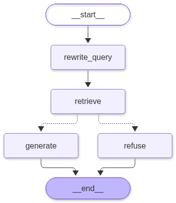

# Architecture



(`img/graph.mmd` holds the Mermaid source rendered by `graph.get_graph().draw_mermaid()`.)

## Components

| Layer | Module | Role |
|---|---|---|
| Sources | `data/kb/sources.yaml`, `scripts/00_download_sources.py` | Inventory with URL + SHA-256; raw files fetched on demand, never committed |
| Ingestion | `ingestion.py` | PDF (pypdf) / HTML (stdlib parser) → cleaned pages → section-aware recursive chunks (500/50) with `doc_id`, `section`, `page` metadata; deterministic chunk ids |
| Embeddings + store | `vectorstore.py` | `EmbeddingCache` (jsonl.gz per doc, resumable, 429 back-off) · `manifest.json` (hash/model/dim/chunking) · Chroma rebuilt from cache via native `add(embeddings=…)` |
| Retrieval | `retrieval.py` | `similarity_search_with_relevance_scores` (unfiltered) → calibrated gate → document routing (metadata filter when the question names documents) → `max_marginal_relevance_search` → `ContextIndex` section expansion → numbered `Source`s and citation strings |
| Prompts | `prompts.py` | `SYSTEM_PROMPTS` v1–v4, `REWRITE_PROMPT`, `build_messages` (adds the answer-language line), `looks_english` |
| Agent | `graph.py`, `memory.py`, `agent.py` | LangGraph `StateGraph` + `InMemorySaver`; `Assistant.ask()` facade used by notebook, app, REPL and evaluation |
| Evaluation | `evaluation.py`, `scripts/03_evaluate.py` | Bilingual golden set → hit-rates, refusal accuracy, keyword coverage |
| UIs | `notebooks/compliance_assistant.ipynb`, `app.py`, `scripts/chat.py` | Same `Assistant`, three surfaces |

## Graph state

```python
class AgentState(MessagesState):  # messages: Annotated[list[AnyMessage], add_messages]
    question: str  # the user's wording (answered in this language)
    standalone_question: str  # English, self-contained; what gets embedded
    language: str  # "en" | "es", decided once per turn
    context: str  # numbered passages "[n] cite\ntext" — NOT in messages
    sources: list[dict]  # Source records for the UI
    grounded: bool  # max_score >= calibrated threshold
    max_score: float
```

Only `messages` is accumulated across turns (the `add_messages` reducer); every other key
is overwritten each turn. Keeping `context` out of `messages` means the checkpointed
thread holds just the dialogue, and the 10-message window counts turns.

## Node contracts

| Node | Reads | Writes | LLM calls |
|---|---|---|---|
| `rewrite_query` | last message, windowed history | `question`, `standalone_question`, `language` | 0 on a first English turn, else 1 |
| `retrieve` | `standalone_question` | `context`, `sources`, `grounded`, `max_score` | 0 (1 query embedding, cached on disk) |
| `route_after_retrieve` | `grounded` | — | 0 → `"generate"` or `"refuse"` |
| `generate` | system prompt, windowed history, `context`, `question`, `language` | `messages` (+AIMessage) | 1 |
| `refuse` | `language`, `max_score` | `messages` (+AIMessage, templated) | 0 |

Per turn: 1 query embedding + 1–2 LLM calls.

## Memory

`InMemorySaver` checkpoints the full state after every super-step under
`config={"configurable": {"thread_id": ...}}`. The notebook creates thread ids explicitly;
the Streamlit app stores one per browser session (`st.session_state`) and rotates it on
"New conversation". `memory.window_history(messages, 10)` trims to the last 10 messages
starting on a human turn before the prompt is built.

## Shared state in the Streamlit app (known limitation)

`st.cache_resource` holds one `Assistant` for every browser session, so the failover index,
the query-vector cache and the `InMemorySaver` are shared across request threads. Threads are
isolated by `thread_id` (one per session, rotated by *New conversation*), but abandoned
threads are never evicted while the process lives, and the two failover indices are
process-wide by design (a daily quota is per key, not per user). Acceptable for a demo; a
production deployment would use `SqliteSaver`/`PostgresSaver` with TTL and per-worker clients.

## Retrieval gate calibration

`scripts/02_sanity_retrieval.py --calibrate` embeds six EN/ES in-domain query pairs and
six out-of-domain queries, records the max relevance score of each, and writes the midpoint
of the gap between the lowest in-domain and the highest out-of-domain score to
`data/kb/calibration.json` (0.6885 with `gemini-embedding-2`, 768 d). `Settings.score_threshold`
is `None` by default so the calibrated value is used; `SCORE_THRESHOLD=` in `.env` overrides.

## Data flow for a build

```
sources.yaml ─▶ 00_download_sources.py ─▶ data/kb/raw/*.pdf|html  (sha256 verified, git-ignored)
                                               │ ingest()
                                               ▼
                             chunks (id = doc:p{page}:c{idx}:{sha1[:8]})
                                               │ embed_missing()  (only ids absent from cache)
                                               ▼
                 data/kb/embeddings/<doc>.jsonl.gz  +  manifest.json   (VERSIONED)
                                               │ rebuild_chroma()  (native add, no API)
                                               ▼
                                     data/chroma/   (derived, git-ignored)
```

## Retrieval details

* **Gate first, unfiltered.** The relevance gate reads the top-k of the whole collection, so
  document routing and expansion can never turn a refusal into an answer or vice versa.
* **Document routing.** `named_documents()` matches the aliases in `data/kb/sources.yaml`
  (`\bE2A\b`; `\bE6\b`, `\bGCP\b`, `good clinical practice`; `helsinki`). Two or more named
  documents share the k slots (3 + 3); one named document gets k − 2 filtered slots plus 2
  unfiltered ones, so a relevant passage elsewhere can still surface. Results are merged
  round-robin.
* **Context expansion.** `ContextIndex` loads every chunk once (`collection.get`, no API),
  orders them by (document, page, chunk) and groups contiguous chunks with the same section
  label. A hit becomes its whole section when that is ≤ 4,000 characters, else the hit plus
  its neighbours inside the section; hits that land in the same passage are merged, and the
  splitter's 50-character overlap is removed when chunks are joined. Citations of passages
  that cross pages read `pp.24–26`.
