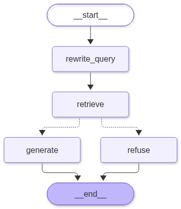
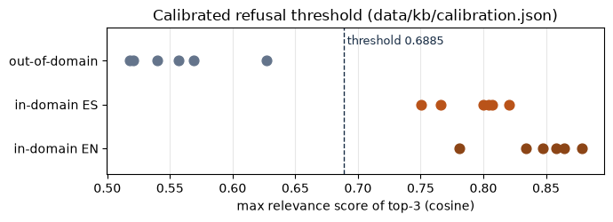
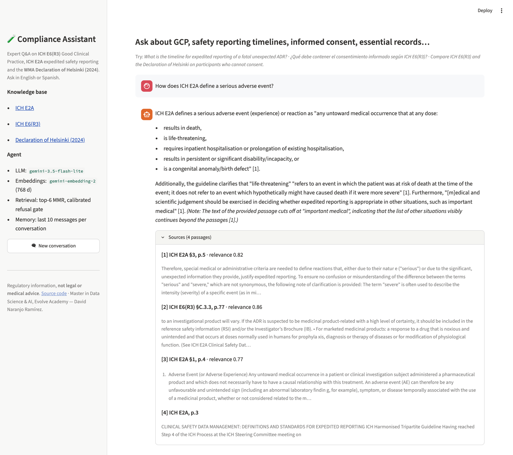

# Asistente de cumplimiento en investigación clínica: manual del proyecto

**Manual completo para personas sin formación en informática.** Explica qué es el asistente,
para qué sirve, cómo funciona por dentro, cómo se comprobó que funciona, cómo usarlo y dónde
están sus límites. No hace falta saber programar para leerlo.

*Autor: David Naranjo Ramírez · Proyecto final del módulo de IA Generativa · Máster en Data
Science & IA, Evolve Academy · Noviembre de 2026 · Versión 1.0.*

## 1. Cómo usar este manual

### A quién va dirigido

A cualquier persona que quiera entender el proyecto sin conocimientos técnicos: un miembro del
tribunal, un profesional de la investigación clínica, un responsable de calidad, un familiar o
un posible empleador. Cada concepto técnico se explica la primera vez que aparece, con una
comparación cotidiana, y se recoge de nuevo en el **glosario** del capítulo 15.

### Cómo está organizado

| Si quiere… | Lea… |
|---|---|
| Saber de qué trata todo en cinco minutos | El capítulo 2, *El proyecto en una página* |
| Entender el problema que resuelve | El capítulo 3, sobre la investigación clínica y sus normas |
| Entender la tecnología sin tecnicismos | Los capítulos 4 y 6 |
| Saber si puede fiarse de sus respuestas | Los capítulos 9 y 11 |
| Usarlo | El capítulo 10, la guía de uso |
| Consultar un término | El capítulo 15, el glosario |

### Convenciones

- Las **negritas** marcan las ideas clave de cada apartado.
- Los recuadros con borde cobre resumen lo esencial o avisan de algo importante.
- Los términos regulatorios se dejan en inglés cuando así se usan en la profesión y en las
  propias normas: *SAE*, *SUSAR*, *sponsor*, *IRB/IEC*. Su significado está en el glosario.
- La aplicación y el código del proyecto están en inglés, porque las normas que consulta están
  en inglés. Este manual está en español porque se dirige a lectores hispanohablantes.

## 2. El proyecto en una página

> **En una frase.** Es un asistente que responde preguntas sobre las normas que rigen los
> ensayos clínicos, citando literalmente el documento, la sección y la página de donde sale
> cada afirmación, y que se niega a responder cuando sus fuentes no contienen la respuesta.

**El problema.** Quien trabaja en un ensayo clínico necesita respuestas exactas a preguntas
como *«¿en cuántos días hay que notificar esta reacción adversa?»* o *«¿qué debe contener el
consentimiento informado?»*. Las respuestas están repartidas en documentos largos, técnicos y en
inglés, y en este ámbito no basta una respuesta aproximada: hay que poder demostrar de dónde
sale.

**La solución.** Un programa que combina dos cosas:

1. Una **biblioteca digital** con tres normas oficiales: la guía ICH E6(R3) de Buenas Prácticas
   Clínicas, la guía ICH E2A sobre notificación urgente de reacciones adversas y la Declaración
   de Helsinki de 2024. En total, unas 90 páginas.
2. Un **modelo de inteligencia artificial** (Gemini, de Google) que redacta las respuestas, pero
   solo a partir de los fragmentos de esas normas que el sistema le entrega, y citándolos.

**Lo que hace bien.**

- Responde en español o en inglés, según el idioma de la pregunta, y cita las normas en su
  inglés original para no perder precisión legal.
- Recuerda la conversación: entiende *«¿y para las demás reacciones?»* porque sabe de qué se
  hablaba.
- Reconoce lo que no sabe: ante una pregunta ajena (*«¿qué fármaco es mejor para adelgazar?»*)
  o sobre una norma que no tiene, lo dice en lugar de inventar.

**Cómo se sabe que funciona.** Se le hizo un examen de 50 preguntas con respuesta conocida y
otro «sorpresa» de 24 preguntas redactadas después de dar el sistema por terminado. En la
versión final, un corrector automático calificó como correctas o casi correctas el 95 % y el
100 % de las respuestas, respectivamente, y nunca rechazó una pregunta que sí podía responder.

**Dónde está.** Una aplicación web pública, un cuaderno interactivo para evaluadores y todo el
código abierto en GitHub (véase el capítulo 10).

**Lo que no es.** No es asesoramiento legal ni médico. Es una herramienta de consulta que
señala dónde dice cada cosa la norma, para que la persona responsable lo compruebe y decida.

## 3. El contexto: la investigación clínica y sus normas

### Qué es un ensayo clínico

Antes de que un medicamento llegue a la farmacia, se prueba en personas voluntarias para
comprobar que es seguro y que funciona. Esas pruebas se llaman **ensayos clínicos**. Son
estudios muy regulados, porque en ellos participan personas que asumen un riesgo para que el
conocimiento médico avance.

### Quién hace qué

| Figura | Qué hace | Término habitual en las normas |
|---|---|---|
| Promotor | La empresa u organización que impulsa y financia el ensayo (normalmente un laboratorio farmacéutico) y responde de él ante las autoridades | *sponsor* |
| Investigador | El médico responsable del ensayo en cada hospital o centro | *investigator* |
| Monitor | Profesional del promotor que visita los centros y comprueba que el ensayo se hace como se planeó | *CRA, clinical research associate* |
| Comité de ética | Grupo independiente que aprueba el ensayo y vigila los derechos de los participantes | *IRB/IEC* |
| Autoridad reguladora | El organismo público que autoriza y supervisa (en España, la AEMPS; en EE. UU., la FDA) | *regulatory authority* |
| Participante | La persona voluntaria que recibe el tratamiento en estudio | *participant* |

### La seguridad de los participantes

Durante un ensayo pueden ocurrir problemas de salud. Las normas distinguen varios tipos, y de
esa clasificación dependen los plazos de aviso:

- **Acontecimiento adverso**: cualquier problema de salud que aparece durante el ensayo, tenga
  o no relación con el medicamento.
- **Acontecimiento adverso grave (*SAE*)**: el que causa la muerte, pone en peligro la vida,
  obliga a hospitalizar o alarga la hospitalización, deja una discapacidad importante o produce
  una malformación congénita.
- **Reacción adversa**: un efecto perjudicial que se sospecha causado por el medicamento.
- **SUSAR**: una reacción adversa que es a la vez **sospechada**, **grave** e **inesperada** (no
  descrita en la información del medicamento). Es la categoría más urgente.

Un ejemplo de la exactitud que se exige: según la guía ICH E2A, una reacción adversa mortal o
que amenaza la vida e inesperada debe comunicarse a las autoridades *«lo antes posible y en un
plazo máximo de 7 días naturales»*, seguida de un informe completo en *8 días más*; las demás
reacciones graves e inesperadas, en un máximo de *15 días*. Equivocarse de plazo es un
incumplimiento normativo.

### Las tres normas que conoce el asistente

| Documento | Qué regula | Quién lo publica |
|---|---|---|
| **ICH E6(R3)**, Buenas Prácticas Clínicas | Cómo debe diseñarse, realizarse y documentarse un ensayo: responsabilidades del investigador y del promotor, consentimiento informado, registros, monitorización | El Consejo Internacional de Armonización (ICH), versión definitiva de enero de 2025 |
| **ICH E2A** | Definiciones de seguridad (grave, inesperado…) y plazos de notificación urgente | ICH, 1994, todavía vigente |
| **Declaración de Helsinki** | Principios éticos de la investigación médica con personas | Asociación Médica Mundial, revisión de octubre de 2024 |

La E6(R3) es tan reciente que muchas herramientas de inteligencia artificial generalistas la
conocen mal o la confunden con la versión anterior. Esa es una de las razones por las que tiene
sentido un asistente que lea la versión oficial en lugar de fiarse de su memoria.

### El problema que resuelve: una escena real

Un viernes a las 17:50, un monitor recibe el aviso de un acontecimiento adverso grave en uno de
sus centros. Las preguntas se le acumulan: *¿es un SUSAR? ¿quién debe notificarlo, a quién y en
qué plazo?* La respuesta está repartida entre la ICH E2A (plazos), la ICH E6(R3) (obligaciones
del investigador y del promotor) y, si afecta a participantes vulnerables, la Declaración de
Helsinki. Y en una inspección no vale decir *«creo que eran quince días»*: hay que citar la
norma.

> **La necesidad concreta.** No basta con encontrar información: hay que encontrar el pasaje
> exacto y poder demostrar de dónde sale. Ese requisito de **trazabilidad** guía todo el diseño
> del proyecto.

### Por qué este autor y este tema

El autor ha trabajado cinco años dando soporte a software de ensayos clínicos (Medidata Rave y
plataformas de Pfizer y Novo Nordisk, en C3i Solutions / HCLTech), tiene la certificación ICH
GCP y su proyecto anterior del máster analizaba datos de farmacovigilancia de los fármacos
GLP‑1 en la base pública FAERS. Elegir un ámbito que conoce de primera mano tiene una ventaja
decisiva: **puede juzgar si una respuesta es correcta**. Sin esa capacidad, evaluar un asistente
experto sería imposible.

## 4. Conceptos básicos, sin tecnicismos

Este capítulo explica las piezas tecnológicas con comparaciones cotidianas. Si ya conoce la
inteligencia artificial generativa, puede pasar al capítulo 5.

### La inteligencia artificial generativa y los modelos de lenguaje

Un **modelo de lenguaje** es un programa entrenado con enormes cantidades de texto para
predecir qué palabras vienen a continuación. A gran escala, esa capacidad le permite redactar,
resumir, traducir y responder preguntas con una fluidez sorprendente. ChatGPT, Claude o Gemini
son ejemplos. Este proyecto usa **Gemini**, de Google, en su versión ligera
(`gemini-3.5-flash-lite`), porque el enunciado del máster lo exige y porque tiene un plan de uso
gratuito.

### El problema de las «alucinaciones»

Un modelo de lenguaje no consulta una base de datos cuando responde: genera texto que *suena*
correcto según lo que aprendió. A veces ese texto es falso pero convincente, por ejemplo, un
plazo inventado o un artículo de una norma que no existe. A esto se le llama **alucinación**. En
un ámbito regulado es el peor fallo posible, porque una respuesta errónea dicha con seguridad
puede llevar a incumplir la ley.

### La solución: un examen «a libro abierto» (RAG)

Imagine dos exámenes. En el primero, el estudiante responde de memoria. En el segundo, puede
consultar el libro de texto, pero debe indicar la página de cada respuesta y, si el libro no
trata la pregunta, debe decirlo.

Este proyecto obliga al modelo a hacer el segundo tipo de examen. La técnica se llama **RAG**
(del inglés *retrieval‑augmented generation*, «generación aumentada con recuperación»):

1. **Recuperar**: antes de responder, el sistema busca en su biblioteca los fragmentos de las
   normas más relacionados con la pregunta.
2. **Generar**: entrega esos fragmentos al modelo con una instrucción clara: *responde solo con
   esto, cita cada afirmación y, si no está aquí, dilo*.

> **Idea clave.** El modelo aporta la capacidad de leer y redactar; las normas aportan el
> contenido. La respuesta queda anclada a un texto verificable.

### Los fragmentos

Las normas son demasiado largas para dárselas enteras al modelo en cada pregunta. Por eso se
dividen en **fragmentos** de unos 500 caracteres, aproximadamente un párrafo corto. Cada
fragmento lleva una etiqueta con su documento, su sección y su página, como la ficha de un
libro en una biblioteca. Las tres normas suman **801 fragmentos**.

### El «mapa del significado» (embeddings)

¿Cómo encuentra el sistema los fragmentos relacionados con una pregunta, si la pregunta no usa
las mismas palabras que la norma? Gracias a los **embeddings**.

Un embedding convierte un texto en una lista de números que describe su significado, como unas
coordenadas en un mapa. Los textos que hablan de lo mismo quedan cerca en ese mapa, aunque usen
palabras distintas o incluso idiomas distintos. *«Plazo para notificar una reacción mortal»* y
*«timeline for expedited reporting of a fatal ADR»* caen en el mismo barrio.

El proyecto usa el modelo de embeddings de Google `gemini-embedding-2`, que describe cada texto
con 768 números. Un detalle técnico con efecto práctico: los fragmentos de las normas se
procesan «en modo documento» y las preguntas «en modo consulta», porque una pregunta y la
respuesta que la satisface no se parecen en la forma, aunque sí en el fondo.

### Una biblioteca ordenada por significado (base de datos vectorial)

Los 801 fragmentos, con sus coordenadas y etiquetas, se guardan en **ChromaDB**, una base de
datos especializada en encontrar «los textos más cercanos a este». Es como una biblioteca en la
que los libros no se ordenan por título, sino por tema, de modo que basta situarse en un punto
del mapa para tener a mano todo lo relacionado.

### Una nota de relevancia y un umbral

Cada fragmento encontrado recibe una **puntuación de relevancia** entre 0 y 1: cuanto más alta,
más se parece al significado de la pregunta. El sistema fija un **umbral**: si ni el mejor
fragmento lo supera, concluye que su biblioteca no trata ese tema y no responde. Ese umbral
(0,69) no se eligió a ojo, sino midiendo, como se explica en el capítulo 9.

### Un procedimiento fijo: el agente y su grafo

En inteligencia artificial se llama **agente** a un programa que encadena varios pasos para
cumplir una tarea. Aquí los pasos están dibujados de antemano en un **grafo**, un diagrama de
flujo como los de los procedimientos de calidad: *entender la pregunta → buscar → decidir si hay
base → responder o rechazar*. La herramienta que ejecuta ese diagrama se llama **LangGraph**.

Hay agentes que deciden por sí mismos si consultan o no una fuente. Aquí no: **el asistente
consulta siempre las normas**, en todas las preguntas, sin excepción. Es una decisión deliberada
que se explica en el capítulo 7.

### La memoria de conversación

Para entender *«¿y para las demás?»*, el asistente necesita recordar la pregunta anterior. Guarda
cada conversación como un hilo independiente, con un identificador propio, y al redactar cada
respuesta tiene en cuenta los **10 últimos mensajes** (5 preguntas y 5 respuestas). Dos personas
que usan la aplicación a la vez no ven las conversaciones del otro.

### Las instrucciones de trabajo (el prompt de sistema)

Al modelo se le entrega, antes de cada pregunta, un texto fijo con sus instrucciones: quién es,
para quién trabaja, qué fuentes tiene, cómo debe citar, en qué idioma responder y qué hacer si
no encuentra la respuesta. Se llama **prompt de sistema** y equivale al manual de procedimientos
de un empleado nuevo. El capítulo 8 cuenta cómo se redactó y se mejoró.

## 5. Las fuentes de conocimiento

### Tres documentos oficiales

| Documento | Edición | Páginas indexadas | Fragmentos |
|---|---|---|---|
| ICH E2A, gestión de datos de seguridad clínica: definiciones y normas de notificación expeditiva | ICH, octubre de 1994 | 3–12 | 68 |
| ICH E6(R3), guía de Buenas Prácticas Clínicas | ICH, 6 de enero de 2025 | 8–86 | 665 |
| Declaración de Helsinki de la Asociación Médica Mundial | Octubre de 2024 | Página web oficial, 37 párrafos numerados | 68 |
| **Total** | | **≈ 90 páginas** | **801** |

Se omiten las portadas, los historiales de versiones y los índices, que no aportan contenido
normativo y confundirían la búsqueda.

### De dónde salen y cómo se garantiza que son auténticos

Los documentos **no se copian en el proyecto**: un pequeño programa los descarga de la web
oficial de cada organismo (ICH y Asociación Médica Mundial). Para asegurarse de que son
exactamente los mismos documentos con los que se construyó el asistente, el proyecto guarda la
**huella digital** de cada uno (un código llamado SHA‑256). Es como el precinto de un envase: si
el organismo cambia una sola coma del documento, la huella no coincide y el programa avisa en
lugar de seguir con un texto distinto.

### Preparación del texto

Un PDF está pensado para imprimirse, no para que un programa lo lea. Antes de dividirlo en
fragmentos, el texto se limpia:

- Se eliminan las **cabeceras y pies de página** que se repiten en cada hoja (por ejemplo, *«ICH
  E6(R3) Guideline»* y el número de página), que de otro modo aparecerían en mitad de las frases.
- Se eliminan las líneas de puntos de los índices.
- Se reúnen las palabras partidas con guion al final de línea.
- Se detecta el **número de sección** de cada párrafo (por ejemplo, *2.8.10*), para poder citarlo.

La Declaración de Helsinki se lee de la página web y no del PDF, porque el PDF que genera la web
separa los números de párrafo de su texto y estropea algunas letras («Clari6cation» en lugar de
«Clarification»). En la página web, en cambio, la numeración de los párrafos viene bien marcada.

### Fragmentos con etiqueta

Cada fragmento conserva tres datos que hacen posible la cita: **documento**, **sección** y
**página**. Gracias a ello, una respuesta puede decir *«ICH E6(R3) §2.8.10, pp. 24–26»* o
*«Declaración de Helsinki (2024) ¶28»*, y el lector puede ir directamente a comprobarlo.

### Derechos de uso

Las guías ICH permiten reproducir su texto siempre que se cite al ICH como fuente y no se
altere. La Declaración de Helsinki pertenece a la Asociación Médica Mundial y se publica
abiertamente para su consulta. El asistente solo cita pasajes breves, literales y atribuidos, y
el proyecto no redistribuye los documentos completos.

## 6. Cómo funciona: el viaje de una pregunta

Este capítulo sigue una pregunta desde que se escribe hasta que aparece la respuesta. El
diagrama resume el recorrido; a continuación se explica cada paso.

### Paso 1: entender la pregunta

El sistema detecta primero si la pregunta está en español o en inglés, para responder en el
mismo idioma.

Después, si la conversación ya había empezado o la pregunta no está en inglés, la **reescribe**
como una pregunta completa y en inglés. Por ejemplo, tras hablar del plazo para las reacciones
mortales, la pregunta *«¿Y para las demás reacciones graves e inesperadas?»* se convierte en
*«What is the timeline for expedited reporting of other serious and unexpected adverse drug
reactions?»*. Hay dos motivos:

- **Resolver las referencias**: *«las demás»* no significa nada sin la conversación anterior.
- **Buscar en el idioma de las normas**: las normas están en inglés y la búsqueda funciona mejor
  en ese idioma. Las mediciones mostraron que las preguntas en español encuentran los mismos
  pasajes, pero con una puntuación algo menor.

La aplicación muestra esta pregunta reescrita bajo la respuesta (*«Searched as: …»*), para que
el usuario vea cómo se ha entendido.

### Paso 2: buscar en la biblioteca

La pregunta reescrita se convierte en coordenadas de significado y se buscan los fragmentos más
cercanos entre los 801. El sistema anota la **puntuación del mejor fragmento**.

### Paso 3: decidir si hay base para responder

Si la mejor puntuación no llega al umbral de **0,69**, el sistema concluye que su biblioteca no
trata el tema. Entonces **no llama al modelo de inteligencia artificial**: devuelve un mensaje
fijo que explica qué temas sí cubre. Así, una pregunta como *«¿Qué fármaco GLP‑1 es mejor para
perder peso?»*, que es un consejo clínico y no una cuestión normativa, se rechaza con una
puntuación de aproximadamente 0,64. El modelo ni siquiera llega a verla, de modo que no puede
inventar nada.

> **Por qué importa.** Las preguntas fuera de tema se paran con un cálculo, no con la buena
> voluntad del modelo. Es una barrera que no depende de que la inteligencia artificial «obedezca».

### Paso 4: elegir los pasajes

Si hay base suficiente, el sistema elige **6 pasajes**:

- **Variados**: si los seis mejores fragmentos dijeran casi lo mismo, se desperdiciaría espacio.
  Una técnica llamada **MMR** (relevancia marginal máxima) busca un equilibrio entre parecerse a
  la pregunta y no repetirse entre sí.
- **Repartidos entre los documentos que se nombran**: si la pregunta menciona expresamente dos
  normas (*«¿qué exigen la E6(R3) y la Declaración de Helsinki…?»*), las seis plazas se reparten
  entre ambas, tres y tres, para que la respuesta pueda contrastarlas. Si nombra una sola, cuatro
  plazas son para esa norma y dos quedan libres por si algo relevante está en otra.

La decisión del paso 3 se toma **antes** de este reparto y con la búsqueda general, de modo que
el reparto nunca puede convertir un rechazo en una respuesta.

### Paso 5: completar el contexto

Un fragmento de 500 caracteres puede cortar una lista por la mitad. Ocurrió de verdad: la
definición de *«grave»* de la ICH E2A tiene cinco criterios, y el fragmento encontrado solo
contenía dos; la respuesta los presentaba como si fueran todos.

Para evitarlo, cada fragmento elegido se **amplía a su sección completa** cuando esta mide como
máximo unos 4.000 caracteres (aproximadamente una página), y si es más larga, se añaden los
fragmentos vecinos. La lista de 22 elementos del consentimiento informado (E6(R3) §2.8.10) mide
3.653 caracteres, y por eso se eligió ese límite. Esta ampliación no tiene coste: los textos ya
están guardados y no hay que pedir nada a Google.

### Paso 6a: redactar la respuesta con citas

El modelo recibe las instrucciones de trabajo, los últimos mensajes de la conversación, los
pasajes **numerados** y la pregunta original, junto con una línea explícita: *«Responde en
español»* o *«Reply in English»*. Con eso redacta una respuesta en la que:

- cada frase con contenido normativo lleva su cita entre corchetes, **[1]**, **[2]**…, que remite
  al panel de fuentes;
- el texto de la norma se cita literalmente, en inglés y entre comillas;
- si dos normas dicen cosas distintas, lo señala y atribuye cada postura a su documento;
- si los pasajes responden solo una parte, responde esa parte y dice cuál falta.

### Paso 6b: rechazar con educación

Si en el paso 3 no hubo base suficiente, la respuesta es un texto fijo, en el idioma del
usuario: *«No he encontrado esto en mi base de conocimiento, así que no voy a improvisar. Puedo
responder preguntas sobre ICH E6(R3), ICH E2A y la Declaración de Helsinki (2024). Prueba a
reformular indicando la guía o el tema.»*

### Paso 7: recordar

La pregunta y la respuesta se guardan en el hilo de la conversación. Los pasajes consultados
**no** se guardan en la memoria: se vuelven a buscar en cada pregunta. Así la memoria se mantiene
ligera y cuenta mensajes, no páginas de normas.

### Un ejemplo completo

| Momento | Primera pregunta | Segunda pregunta, en el mismo hilo |
|---|---|---|
| El usuario escribe | *What is the timeline for expedited reporting of a fatal unexpected ADR?* | *¿Y para las demás reacciones graves e inesperadas?* |
| Idioma detectado | Inglés | Español |
| Pregunta usada para buscar | La misma (primera pregunta y ya en inglés) | *What is the timeline for expedited reporting of other serious and unexpected adverse drug reactions?* |
| Mejor puntuación | 0,87 (por encima de 0,69) | 0,87 |
| Decisión | Responder | Responder |
| Respuesta | 7 días naturales desde que el promotor conoce el caso, más 8 días para el informe completo, citado literalmente de ICH E2A, p. 7 | En español: 15 días naturales, con la frase original de la norma entre comillas |

### Cuánto «cuesta» cada pregunta

Cada pregunta supone una consulta a Google para calcular sus coordenadas de significado (y se
guarda, de modo que repetir la misma pregunta no vuelve a costar) y una o dos consultas al
modelo de lenguaje: una para reescribir la pregunta, si hace falta, y otra para redactar la
respuesta. Los rechazos no consultan al modelo.

## 7. Las decisiones de diseño y su porqué

| Decisión | Alternativa descartada | Por qué |
|---|---|---|
| Consultar **siempre** las normas, con un procedimiento fijo | Un agente que decide por sí mismo si busca | El enunciado exige usar la base de conocimiento en cada consulta; un procedimiento fijo hace menos consultas al modelo (que cuestan cuota) y se puede seguir paso a paso |
| Rechazar con un **umbral medido** | Dejar que el modelo decida si sabe la respuesta | El modelo puede creer que sabe y equivocarse; un umbral calculado con datos es predecible y comprobable |
| **Rechazos con texto fijo**, sin modelo | Pedir al modelo que redacte el rechazo | Lo que nunca llega al modelo no se puede inventar |
| Ampliar cada fragmento a su **sección completa** | Pedir al modelo que «no deje listas incompletas» | El modelo no puede completar lo que no ve; el problema estaba en la búsqueda, no en la redacción |
| Buscar **en inglés**, responder en el idioma del usuario | Traducir las normas | Las normas tienen valor legal en su redacción original; la traducción de la pregunta es barata y la cita literal mantiene la precisión |
| Línea fija *«Responde en español»* en cada petición | Confiar en la instrucción general | En las pruebas, la instrucción general no bastó: una pregunta en inglés recibió una vez respuesta en español |
| Memoria de **10 mensajes** | Toda la conversación | Suficiente para seguir el hilo (incluido *«resume lo que me has dicho»*) sin alargar cada petición ni consumir cuota |
| Guardar los **cálculos de significado** en el proyecto | Recalcularlos cada vez | El plan gratuito permite 1.000 cálculos al día; la biblioteca necesita unos 800. Guardados, la biblioteca se reconstruye en segundos sin gastar cuota |
| Dos **claves de acceso** de proyectos distintos | Una sola | La cuota diaria es por proyecto de Google; si la primera se agota, el sistema pasa a la segunda automáticamente |

## 8. Las instrucciones del asistente y cómo se mejoraron

Las instrucciones de trabajo del modelo (el prompt de sistema) pasaron por cuatro versiones.
Cada cambio respondió a un fallo **observado**, no a una suposición.

| Versión | Qué añadía | Qué se observó |
|---|---|---|
| v1, la de clase | Solo *«responde a partir de los documentos de forma concisa»* | Respuestas correctas y fluidas, pero **sin citas**: imposible saber de qué pasaje salía cada frase |
| v2 | Papel, público, temas y la regla *«si no está en el contexto, dilo»* | Paso intermedio de diseño, no evaluado por separado |
| v3 | Citas numeradas en cada frase, atribución cuando las normas difieren, política de idioma, formato | Buenas respuestas citadas, pero el examen completo destapó tres fallos: una pregunta de varios pasos **rechazada entera** aunque todos los pasos estaban en las fuentes; ese rechazo, en una pregunta en español, **escrito en inglés**; y **listas cortadas** presentadas como completas |
| **v4, en uso** | Rechazo graduado (responder la parte cubierta y decir cuál falta), respuestas paso a paso con cita en cada paso, listas completas o aviso de que continúan, todo en el idioma del usuario | Resuelve los tres fallos; mejora medida en el capítulo 9 |

> **Una lección de diseño.** Las reglas que no admiten excepción se programan; el criterio se
> deja a las instrucciones. El idioma de la respuesta y el rechazo de lo que no tiene base no
> dependen de que el modelo obedezca: están en el código. Las listas cortadas se arreglaron en
> la búsqueda (capítulo 6, paso 5), no pidiéndole más al modelo.

Queda un residuo conocido: el modelo suele añadir al final una nota de *«esto es información
regulatoria, no asesoramiento legal ni médico»*, aunque las instrucciones le piden no añadir
avisos. En este ámbito el aviso es deseable, y corregirlo exigiría repetir toda la evaluación,
así que se dejó documentado para después de la entrega.

## 9. Cómo se comprobó que funciona

Un asistente experto solo es útil si se puede demostrar que acierta. El proyecto se evaluó en
cuatro capas, de lo más sencillo a lo más exigente.

### Primera capa: comprobar la búsqueda antes de conectar la inteligencia artificial

Antes de dejar que el modelo redactara nada, se comprobó que la biblioteca encontraba los
pasajes correctos. Se usaron **6 preguntas del ámbito**, cada una en inglés y en español, y **6
preguntas ajenas** (la receta de la paella valenciana, la capital de Bulgaria, el ganador de la
Champions League, qué fármaco es mejor para adelgazar…). Para cada una se anotó la puntuación
del mejor fragmento.

El resultado fue nítido: las preguntas del ámbito puntuaron entre **0,75 y 0,88**; las ajenas,
entre **0,52 y 0,63**. Los dos grupos no se solapan, y el umbral de rechazo se fijó en el **punto
medio del hueco** (0,6885). El español puntúa unas cuatro centésimas por debajo del inglés, pero
encuentra los mismos pasajes.

### Segunda capa: el examen de prueba (golden set)

Se redactó un examen de **25 preguntas con respuesta conocida**, cada una en inglés y en español,
lo que da **50 ejecuciones**:

- **19 preguntas del ámbito**, cada una con el documento y la sección que la responden (dos de
  ellas necesitan combinar dos normas);
- **4 preguntas ajenas**, que deben rechazarse;
- **2 preguntas sobre normas que el asistente no tiene** (la norma estadounidense 21 CFR Part 50
  y el reglamento europeo de ensayos clínicos), que parecen del ámbito pero deben responderse con
  un honesto *«no está en mi base de conocimiento»*.

Las preguntas se redactaron a partir del texto verificado de las normas, con ayuda de
herramientas de inteligencia artificial, y el autor las revisó como experto; además, una prueba
automática comprueba que cada documento y sección de referencia existe en el texto indexado.
Para cada respuesta se midió si se encontró el documento y la sección
correctos, si se rechazó lo que debía rechazarse y si la respuesta contenía los datos clave
(*«7 días naturales»*, *«inmediatamente»*…).

### Tercera capa: un corrector automático (juez)

Contar palabras clave es una aproximación. Para valorar si una respuesta es **correcta**, se
escribió para cada pregunta una **respuesta de referencia**, redactada a partir del texto de la
norma y revisada por el autor, y un modelo de
inteligencia artificial actuó como corrector: comparó cada respuesta con su referencia y la
calificó como *correcta* (1 punto), *parcialmente correcta* (0,5) o *incorrecta* (0), explicando
qué faltaba o qué estaba mal.

### Cuarta capa: el examen sorpresa (held‑out)

Hay un riesgo en mejorar un sistema mirando siempre el mismo examen: acabar «aprendiéndose las
preguntas». Para descartarlo, cuando la versión final quedó cerrada se redactaron **12 preguntas
nuevas** sobre temas que el primer examen no tocaba (desenmascaramiento, comités de ética,
monitorización, desviaciones del protocolo, publicación de resultados, biobancos, compensación
por daños…). Se ejecutaron **una sola vez** y no se cambió nada después.

### Resultados

| Indicador | Antes de las mejoras (v3) | Versión final (v4) |
|---|---|---|
| Corrección según el juez, examen de prueba (38 respuestas del ámbito) | 0,78 | **0,95** |
| Corrección según el juez, examen sorpresa (20 respuestas del ámbito) | 0,95 | **1,00** |
| Datos clave presentes en la respuesta, examen de prueba | 82 % | **97 %** |
| Documento correcto encontrado | 100 % | 100 % |
| Preguntas ajenas rechazadas | 100 % | 100 % |
| Preguntas del ámbito rechazadas por error | 0 | 0 |
| Honestidad ante normas que no tiene | 100 % | 100 % |

En el examen de prueba, la versión final obtuvo 35 respuestas correctas, 2 parcialmente correctas
y 1 incorrecta, frente a 23, 13 y 2 de la versión anterior.

### Cómo leer estas cifras

- **El juez es el mismo modelo que responde**, porque el modelo grande, más adecuado como juez,
  solo permite 20 consultas al día en el plan gratuito. Para medir ese sesgo, ambos jueces
  calificaron las mismas 38 respuestas: coincidieron en el **79 %** de los casos y el juez grande
  fue **más estricto** (0,70 frente a 0,78). Las cifras absolutas deben leerse, por tanto, como
  algo optimistas. La comparación entre versiones sí es justa, porque usa el mismo juez en todo.
- **La mejora no se debe solo a las instrucciones**: v4 llegó junto con la ampliación a la sección
  completa y el reparto entre documentos, porque los fallos que corrigen aparecieron juntos.
- **El examen sorpresa mejora menos** porque sus preguntas se responden con una sola sección, donde
  el corte de listas apenas afectaba. Lo importante es que no empeoró.
- **Son exámenes pequeños.** 50 y 24 ejecuciones bastan para detectar fallos y mejoras claras,
  pero no para afirmar diferencias finas con rigor estadístico.

### Lo que no salió perfecto

El proyecto informa de sus debilidades en lugar de ajustar el sistema al examen hasta ocultarlas:

- **Preguntas de varios saltos.** *«Del investigador a la autoridad: ¿quién notifica a quién y en
  qué plazo?»* necesita encadenar tres pasajes de dos normas. La versión final ya no la rechaza y
  responde paso a paso, pero una sola búsqueda no trae todos los eslabones: en español la
  respuesta omitió el primer paso (del investigador al promotor) y el juez la calificó como
  incorrecta. Es la única respuesta incorrecta de la versión final. La solución natural, para una
  versión futura, es dividir la pregunta y hacer una búsqueda por eslabón.
- **El reparto entre documentos tiene un coste.** En la pregunta que compara la E6(R3) y la
  Declaración de Helsinki, las plazas reservadas a la E6(R3) eligieron secciones generales en lugar
  del principio que mejor responde. La respuesta en español sigue citándolo; la inglesa se calificó
  como parcialmente correcta.
- **Los indicadores miden corrección, no fidelidad.** Comprueban si la respuesta es correcta frente
  a la referencia, no si cada frase está respaldada por el pasaje que cita. Un juez de fidelidad es
  la siguiente medición prevista.

### Las pruebas automáticas del software

Además de evaluar las respuestas, el código tiene **77 pruebas automáticas** que se ejecutan sin
conexión a internet, con un modelo y unos embeddings simulados: comprueban, entre otras cosas, que
la memoria respeta la ventana de 10 mensajes, que dos conversaciones no se mezclan, que una
pregunta ajena se rechaza y que la biblioteca no vuelve a procesar lo que ya tiene.

## 10. Guía de uso

### Dónde está el asistente

| Forma de uso | Para quién | Dónde |
|---|---|---|
| **Aplicación web** | Cualquier persona, desde el navegador | <https://clinical-research-compliance-assistant-eaksdytvqzbpuvthkakvrd.streamlit.app> |
| **Cuaderno interactivo** (*notebook*) | Evaluadores y personas técnicas: muestra cada paso con sus resultados | `notebooks/compliance_assistant.ipynb` en el repositorio |
| **Terminal** | Personas técnicas | `scripts/chat.py` |
| **Código y documentación** | Quien quiera revisarlo o reproducirlo | <https://github.com/dnarram/clinical-research-compliance-assistant> |

### La aplicación web, elemento a elemento

| Elemento | Dónde | Qué es |
|---|---|---|
| Logotipo y título | Arriba a la izquierda | Identidad del proyecto |
| *Knowledge base* | Barra lateral | Las tres normas, con enlace a su fuente oficial |
| *Agent* | Barra lateral | Modelo usado, número de pasajes por respuesta y tamaño de la memoria |
| *New conversation* | Barra lateral | Empieza un hilo nuevo; el asistente olvida la conversación anterior |
| Cuadro *Your question (EN / ES)* | Abajo | Donde se escribe la pregunta, en español o en inglés |
| Respuesta con números entre corchetes | Centro | Cada número remite a un pasaje del panel de fuentes |
| *Sources (N passages)* | Bajo la respuesta, desplegable | Los pasajes usados: documento, sección, página, puntuación de relevancia y el texto |
| *Searched as: …* | Bajo la respuesta | La pregunta tal como se reescribió para buscar (aparece cuando difiere de la original) |
| *No passage scored above the refusal threshold* | Bajo un rechazo | Indica que ninguna fuente superó el umbral y con qué puntuación |

### Cómo hacer buenas preguntas

- **Pregunte por lo que dicen las normas**, no por lo que debe hacerse en un caso concreto:
  *«¿Qué plazo fija la ICH E2A para…?»* funciona mejor que *«¿Qué hago con mi paciente?»*.
- **Nombre la norma si la conoce.** *«Según la ICH E6(R3)…»* dirige la búsqueda hacia ese documento.
- **Una cosa cada vez.** Las preguntas que encadenan muchos pasos son las más difíciles (capítulo 9).
- **Aproveche la memoria**: puede seguir con *«¿y en el caso de…?»* o *«resume lo que me has dicho»*.
- **Pida comparaciones** nombrando ambas normas: *«Compara la E6(R3) y la Declaración de Helsinki
  sobre…»*.

Preguntas que funcionan bien:

- *¿Qué plazo hay para notificar una reacción adversa mortal e inesperada?*
- *¿Qué debe contener el consentimiento informado según ICH E6(R3)?*
- *¿Qué diferencia hay entre un acontecimiento adverso grave y un SUSAR?*
- *Under ICH E6(R3), what must the investigator do when a serious adverse event occurs?*
- *¿Qué dice la Declaración de Helsinki sobre el uso de placebo?*

### Cómo interpretar la respuesta

1. Lea la **primera frase**: es la respuesta directa.
2. Fíjese en las **citas entre corchetes** y abra el panel **Sources** para ver el texto de cada una.
3. Si la respuesta dice que **una parte no está cubierta**, créalo: es la regla del rechazo graduado.
4. Para cualquier decisión con consecuencias, **compruebe el pasaje en el documento oficial**: el
   panel indica sección y página, y la barra lateral enlaza cada norma.

### Qué no esperar

- Respuestas sobre normas que no tiene: la legislación estadounidense, la europea o la española, o
  los módulos de farmacovigilancia de la Agencia Europea del Medicamento.
- Consejo médico o legal sobre un caso concreto.
- Información posterior a las versiones indexadas de las normas.

### El cuaderno interactivo, para evaluadores

El cuaderno (*notebook*) es un documento que mezcla explicaciones y código ejecutado, con sus
resultados guardados. Permite comprobar el proyecto sin instalar nada, leyéndolo en GitHub, y está
organizado en once secciones: preparación, biblioteca, limpieza del texto, construcción de la base,
comprobación de la búsqueda, prompt, agente, memoria, seis conversaciones documentadas, evaluación y
una celda para conversar con el asistente.

### Si algo falla

| Lo que ve | Causa probable | Qué hacer |
|---|---|---|
| La aplicación muestra que está «dormida» | El alojamiento gratuito suspende las aplicaciones sin uso | Pulse el botón para despertarla y espere un minuto |
| *The model call failed (free-tier rate limit…)* | Se ha superado el límite de consultas por minuto o por día del plan gratuito | Espere un minuto; si persiste, la cuota diaria se ha agotado y se renueva al día siguiente |
| Rechaza una pregunta que sí es del ámbito | La pregunta es demasiado general o ambigua | Reformúlela nombrando la norma o el concepto |
| Responde en otro idioma | Caso raro, documentado | Repita la pregunta; el panel de fuentes sigue siendo válido |

## 11. Límites, riesgos y uso responsable

- **Solo conoce tres documentos.** Lo demás lo rechaza o lo responde con lo que dicen esas tres
  normas, y lo advierte.
- **Puede equivocarse.** La evaluación muestra una tasa de acierto alta pero no perfecta, y el juez
  es algo optimista. La respuesta es un punto de partida, no una conclusión.
- **Las preguntas de varios pasos** son su punto débil conocido.
- **El umbral de rechazo es específico** de esta biblioteca y de este modelo de embeddings: si se
  añaden documentos o se cambia el modelo, hay que volver a medirlo.
- **La memoria vive mientras la aplicación está en marcha**: si se reinicia, olvida las
  conversaciones.
- **No sustituye al profesional.** La responsabilidad de interpretar la norma y aplicarla a un caso
  es de la persona y de su organización.

> **Uso responsable.** Utilice el asistente para localizar y entender lo que dice la norma. Antes de
> actuar, lea el pasaje citado en el documento oficial y, si hay dudas, consulte con el
> departamento regulatorio o de calidad de su organización.

## 12. Privacidad, seguridad y costes

### Privacidad

- Las preguntas se envían a los servicios de **Google Gemini** para procesarlas. **No introduzca
  datos personales de pacientes ni información confidencial** de un ensayo. Las condiciones de uso
  de los datos son las del plan de Google utilizado.
- La aplicación pública **no guarda las preguntas** de los visitantes en el proyecto. Las
  conversaciones se mantienen en la memoria del servidor mientras la aplicación está en marcha y
  cada hilo es independiente.

### Seguridad

- La **clave de acceso** a Google (la contraseña que permite usar Gemini) nunca está escrita en el
  código ni en los documentos: se guarda en un archivo local privado o en la configuración secreta
  del alojamiento.
- Un control automático impide publicar en el repositorio cualquier texto con aspecto de clave.
- El programa nunca muestra la clave; como mucho, su longitud para comprobar que existe.

### Costes

El proyecto funciona íntegramente con el **plan gratuito** de Google Gemini y el alojamiento
gratuito de Streamlit Cloud. Las limitaciones de ese plan condicionaron varias decisiones:

| Recurso | Límite del plan gratuito | Cómo se gestiona |
|---|---|---|
| Cálculo de significado de textos | 1.000 al día por proyecto de Google | La biblioteca (≈ 800) se calculó una vez y se guarda en el proyecto; las preguntas repetidas se reutilizan |
| Juez grande | 20 consultas al día | Se usó el modelo ligero como juez y se midió su coincidencia con el grande |
| Cuota diaria agotada | Por proyecto de Google | Segunda clave de otro proyecto, con cambio automático |
| Demostración en directo | Riesgo de quedarse sin cuota | Modo de reproducción con las respuestas de la demostración grabadas |

## 13. Cómo se construyó

### Las herramientas, en lenguaje llano

| Herramienta | Para qué sirve aquí |
|---|---|
| **Python** | El lenguaje de programación en que está escrito el proyecto |
| **Gemini** (Google) | El modelo que redacta y el que calcula los significados |
| **ChromaDB** | La biblioteca ordenada por significado |
| **LangChain y LangGraph** | Las piezas que conectan el modelo con la biblioteca y ejecutan el procedimiento fijo |
| **Jupyter** | El cuaderno interactivo |
| **Streamlit** | La aplicación web y su alojamiento gratuito |
| **GitHub** | El repositorio público donde vive el código, con su historial completo de cambios |

### Trazabilidad del propio proyecto

El proyecto aplica a sí mismo la exigencia de trazabilidad que pide a las respuestas:

- Cada decisión técnica está **fechada y justificada** en un registro de decisiones.
- La evaluación guarda **todas las respuestas generadas y todas las calificaciones** del juez, para
  que cualquiera pueda comprobar cada cifra.
- La biblioteca se puede **reconstruir exactamente** desde los documentos oficiales gracias a sus
  huellas digitales.
- Los cálculos de significado ya hechos se guardan, de modo que cualquiera puede ejecutar el
  asistente sin volver a gastar cuota.

### Identidad visual

Todas las piezas visuales (la aplicación, las diapositivas, los gráficos y este manual) siguen el
**manual de identidad de marca DNR** del autor: tipografía Inter, azul medianoche para los títulos,
cobre como único color de acento, colores planos y el logotipo en la versión adecuada al fondo.

## 14. Preguntas frecuentes

**¿Es lo mismo que preguntarle a ChatGPT?**
No. Un asistente generalista responde de memoria y puede inventar. Este busca primero en las normas
oficiales, responde solo con lo que encuentra, cita cada afirmación y rechaza lo que no está.

**¿Puede inventarse una cita?**
El diseño lo hace muy difícil: el modelo solo recibe pasajes numerados y debe citar esos números, y
las preguntas sin base suficiente ni siquiera le llegan. En la evaluación no se observaron citas
inventadas, pero la fidelidad de cada frase a su pasaje no se ha medido de forma sistemática
(capítulo 9).

**¿Por qué responde en español pero cita en inglés?**
Porque el texto con valor normativo es el original inglés. Traducirlo podría cambiar matices
legales; la explicación va en el idioma del usuario y la cita, literal.

**¿Por qué no contesta a preguntas sobre la legislación española o europea?**
Porque no están en su biblioteca. Añadirlas es técnicamente sencillo (la incorporación de
documentos es automática), pero exige volver a medir el umbral y repetir la evaluación. Está
previsto como siguiente paso.

**¿Qué pasa si se actualiza una norma?**
La huella digital del documento deja de coincidir y el sistema avisa. Tras revisar el cambio, se
vuelve a procesar solo ese documento.

**¿Recuerda lo que le pregunté ayer?**
No. Recuerda la conversación en curso, hasta los 10 últimos mensajes, mientras la aplicación esté
en marcha.

**¿Quién ha comprobado que las respuestas de referencia son correctas?**
Se redactaron a partir del texto de las normas, con ayuda de herramientas de inteligencia
artificial, y las revisó el autor, que trabaja en este ámbito. Además, una prueba automática
comprueba que cada sección citada en el examen existe en el texto indexado.

**¿Cuánto cuesta usarlo?**
Nada en su configuración actual, dentro de los límites del plan gratuito de Google.

**¿Se podría usar en una empresa?**
Como prototipo, sí. Para un uso real habría que añadir más normas, memoria permanente, control de
accesos, un acuerdo de tratamiento de datos con el proveedor del modelo y una validación formal,
como exige cualquier sistema informático en un entorno regulado.

## 15. Glosario

| Término | Significado |
|---|---|
| **Acontecimiento adverso** | Cualquier problema de salud que aparece en un participante durante un ensayo, tenga o no relación con el medicamento |
| **ADR** (*adverse drug reaction*) | Reacción adversa a un medicamento: efecto perjudicial que se sospecha causado por él |
| **Agente** | Programa que encadena varios pasos (buscar, decidir, redactar) para cumplir una tarea |
| **Alucinación** | Respuesta falsa pero convincente generada por un modelo de lenguaje |
| **AMM / WMA** | Asociación Médica Mundial, autora de la Declaración de Helsinki |
| **API** | Puerta de acceso que permite a un programa usar los servicios de otro (aquí, los de Google) |
| **Base de conocimiento** | El conjunto de documentos que el asistente puede consultar |
| **Base de datos vectorial** | Base de datos que encuentra textos por la cercanía de su significado; aquí, ChromaDB |
| **Biobanco** | Colección de muestras biológicas y datos asociados para investigación |
| **Caché** | Copia guardada de un resultado para no tener que calcularlo de nuevo |
| **Clave de acceso (API key)** | Contraseña que permite usar un servicio como Gemini; nunca debe publicarse |
| **Comité de ética (IRB/IEC)** | Grupo independiente que aprueba un ensayo y protege a los participantes |
| **Consentimiento informado** | Aceptación libre y documentada de participar, tras recibir toda la información necesaria |
| **CRA** (*clinical research associate*) | Monitor de ensayos clínicos |
| **Cuaderno (notebook)** | Documento interactivo que combina texto, código y resultados |
| **Cuota** | Número máximo de usos permitidos de un servicio en un periodo |
| **Embedding** | Lista de números que representa el significado de un texto, como unas coordenadas en un mapa |
| **Ensayo clínico** | Estudio en personas para comprobar la seguridad y la eficacia de un tratamiento |
| **Farmacovigilancia** | Vigilancia de la seguridad de los medicamentos |
| **Fragmento (chunk)** | Trozo de unos 500 caracteres en que se divide una norma para buscarla |
| **GCP / BPC** | *Good Clinical Practice*, Buenas Prácticas Clínicas: la norma internacional de calidad ética y científica de los ensayos |
| **Gemini** | Familia de modelos de inteligencia artificial de Google |
| **Golden set** | Examen de preguntas con respuesta conocida usado para medir el sistema |
| **Grafo** | Diagrama de pasos y decisiones que el agente sigue siempre |
| **Held‑out** | Conjunto de preguntas reservado y no usado al mejorar el sistema, para comprobar que las mejoras se generalizan |
| **Hilo (thread)** | Una conversación independiente, con su propia memoria |
| **Huella digital (SHA‑256)** | Código calculado a partir de un archivo que cambia si el archivo cambia; sirve para verificar su autenticidad |
| **ICH** | Consejo Internacional de Armonización de los requisitos técnicos de medicamentos de uso humano |
| **Investigador** | Médico responsable del ensayo en un centro |
| **Juez (LLM‑as‑judge)** | Modelo de inteligencia artificial usado para calificar respuestas frente a una referencia |
| **LangGraph** | Herramienta que ejecuta el procedimiento del agente paso a paso |
| **LLM** | *Large language model*, modelo de lenguaje de gran tamaño |
| **MMR** | Técnica que elige pasajes relevantes pero variados entre sí |
| **Modelo de lenguaje** | Programa entrenado con mucho texto para generar texto |
| **Plan gratuito** | Modalidad de uso sin coste de un servicio, con límites de cuota |
| **Promotor (sponsor)** | Organización que impulsa, financia y responde de un ensayo |
| **Prompt de sistema** | Instrucciones fijas que recibe el modelo antes de cada pregunta |
| **Puntuación de relevancia** | Número entre 0 y 1 que indica cuánto se parece un pasaje a la pregunta |
| **RAG** | Técnica que hace buscar al sistema en documentos antes de responder y responder con ellos |
| **Reescritura de la pregunta** | Paso que convierte la pregunta en una pregunta completa y en inglés para buscar |
| **Representante legalmente aceptable** | Persona autorizada para consentir en nombre de quien no puede hacerlo |
| **Repositorio** | Carpeta pública del proyecto en GitHub, con su historial de cambios |
| **SAE** (*serious adverse event*) | Acontecimiento adverso grave |
| **Sección / párrafo** | Unidad numerada de una norma (por ejemplo, §2.8.10 o ¶28), que el asistente cita |
| **Streamlit** | Herramienta para crear aplicaciones web sencillas, con alojamiento gratuito |
| **SUSAR** | Sospecha de reacción adversa grave e inesperada |
| **Umbral** | Puntuación mínima (0,69) para considerar que la biblioteca trata el tema de la pregunta |
| **Ventana de memoria** | Número de mensajes recientes (10) que el asistente tiene en cuenta |

## Anexo A. Ejemplos de conversación

Respuestas reales de la demostración grabada, abreviadas. Las citas de las normas aparecen en su
inglés original, como en la aplicación.

**1. Un plazo, en inglés.** *What is the timeline for expedited reporting of a fatal unexpected
ADR?*
Responde que las autoridades deben ser notificadas *«as soon as possible but no later than 7
calendar days after first knowledge by the sponsor that a case qualifies»* [1], *«followed by as
complete a report as possible within 8 additional calendar days»* [1]. Fuente principal: ICH E2A,
p. 7. Mejor puntuación: 0,87.

**2. La memoria y el idioma.** En el mismo hilo: *¿Y para las demás reacciones graves e
inesperadas?*
Buscada como *«What is the timeline for expedited reporting of other serious and unexpected adverse
drug reactions?»*. Responde en español que deben presentarse *«as soon as possible but no later
than 15 calendar days after first knowledge by the sponsor that the case meets the minimum criteria
for expedited reporting»* [1].

**3. Dos normas, atribuidas por separado.** *¿Qué exigen ICH E6(R3) y la Declaración de Helsinki para
incluir a participantes que no pueden dar su consentimiento?*
Reparte la búsqueda entre las dos normas y contrasta: la E6(R3) pide el consentimiento de los
*«legally acceptable representatives, acting in the participant's best interest»* y el asentimiento
del menor cuando proceda; la Declaración de Helsinki (¶28) pide el del *«legally authorized
representative, considering preferences and values expressed by the potential participant»*. Cada
postura, con su cita.

**4. Un rechazo sin modelo.** *¿Qué fármaco GLP‑1 es mejor para perder peso?*
Mejor puntuación 0,645, por debajo del umbral. Respuesta fija: *«No he encontrado esto en mi base de
conocimiento, así que no voy a improvisar…»*. El modelo de lenguaje no llega a ver la pregunta.

**5. Una norma que no tiene.** *What does 21 CFR Part 50 say about informed consent?*
La búsqueda encuentra pasajes sobre consentimiento (puntuación 0,77, por encima del umbral), pero el
modelo responde que no encuentra información sobre la 21 CFR Part 50 en su base de conocimiento y
enumera lo que sí cubre. No inventa contenido de la norma estadounidense.

**6. Una lista larga, completa.** *¿Qué debe contener el consentimiento informado según ICH E6(R3)?*
Enumera los elementos de la §2.8.10, de *«(a) The purpose of the trial»* en adelante, gracias a la
ampliación a la sección completa. Antes de esa mejora, la respuesta se detenía en el cuarto.

## Anexo B. Cifras clave

| Concepto | Valor |
|---|---|
| Documentos en la biblioteca | 3 (ICH E2A, ICH E6(R3), Declaración de Helsinki 2024) |
| Páginas de contenido | ≈ 90 |
| Fragmentos | 801, de 500 caracteres con 50 de solapamiento |
| Modelo de significado | `gemini-embedding-2`, 768 números por texto |
| Modelo de redacción | `gemini-3.5-flash-lite` |
| Pasajes por respuesta | 6, variados (MMR), ampliados a su sección hasta 4.000 caracteres |
| Umbral de rechazo | 0,6885 |
| Memoria | 10 últimos mensajes por conversación |
| Consultas al modelo por pregunta | 1 o 2 (0 en los rechazos) |
| Examen de prueba | 25 preguntas × 2 idiomas = 50 ejecuciones |
| Examen sorpresa | 12 preguntas × 2 idiomas = 24 ejecuciones |
| Corrección juzgada, examen de prueba | 0,78 → 0,95 |
| Corrección juzgada, examen sorpresa | 0,95 → 1,00 |
| Coincidencia entre jueces | 79 % (el juez grande, más estricto) |
| Pruebas automáticas del software | 77 |

## Anexo C. Documentos del proyecto para saber más

| Documento | Contenido |
|---|---|
| `README.md` | Presentación técnica del proyecto, instalación y resultados |
| `docs/architecture.md` | Arquitectura técnica detallada |
| `docs/decisions.md` | Registro fechado de decisiones |
| `docs/prompt_iterations.md` | Las cuatro versiones de las instrucciones y lo observado en cada una |
| `docs/evaluation.md` | Resultados detallados del examen de prueba, pregunta a pregunta |
| `docs/sources.md` | Fuentes, ediciones y derechos de uso |
| `docs/brand_application.md` | Aplicación de la identidad visual DNR |
| `docs/notas_orador_es.md` | Guion de la presentación oral |
| `docs/articulo/discurso_presentacion_es.md` | Discurso de la presentación (8 minutos como máximo), base para un artículo académico |
| `notebooks/compliance_assistant.ipynb` | El cuaderno con todo el proceso ejecutado |
